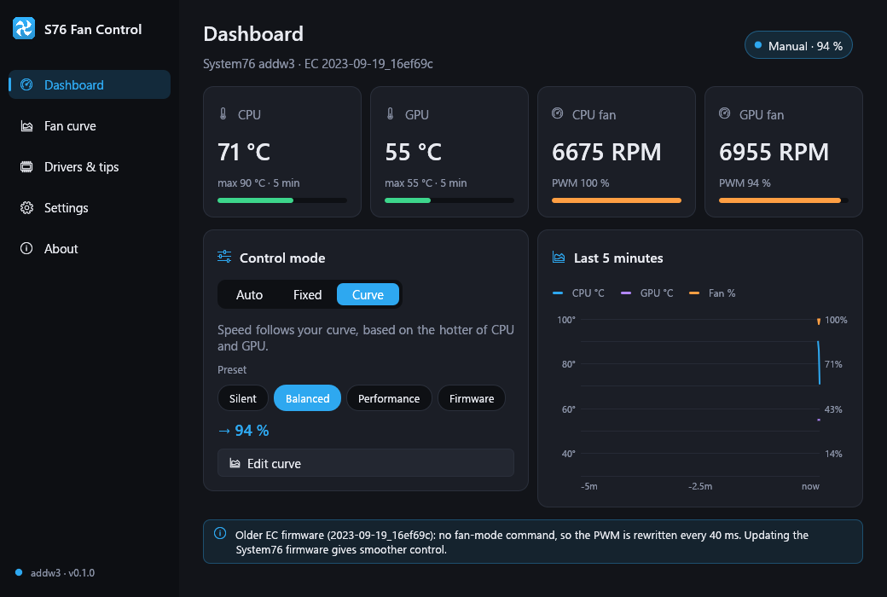
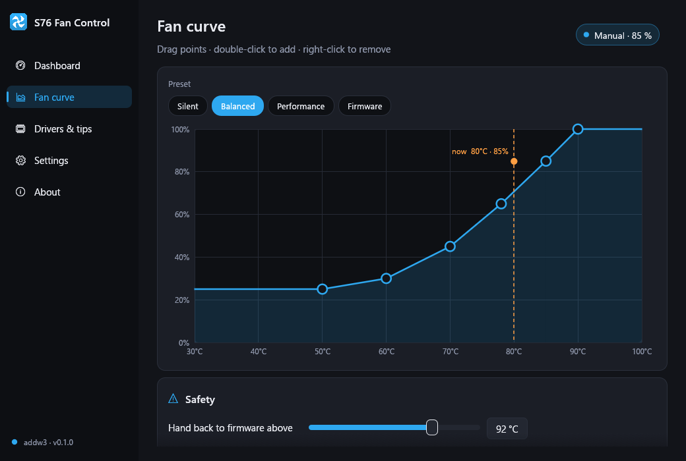
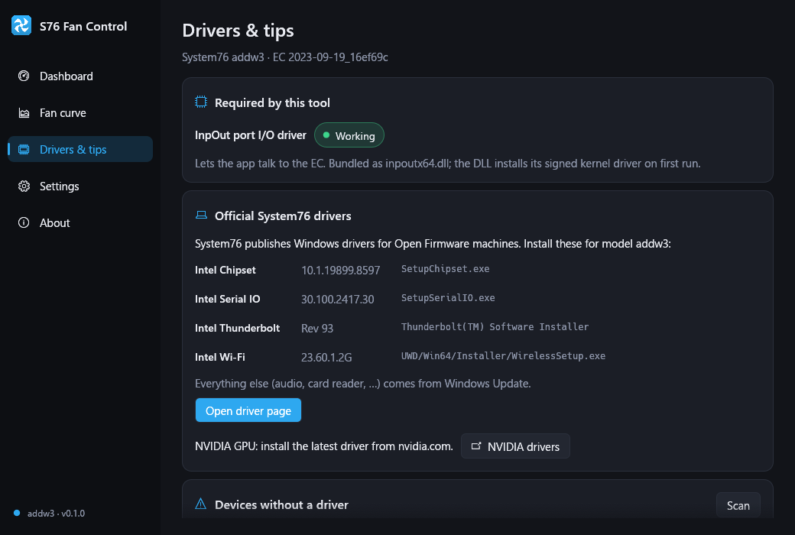

# NANOSystem76Fan — S76 Fan Control for Windows

**Fan control for the System76 Adder WS (addw3) running Windows 10/11**, and for other
System76 laptops with **System76 Open Firmware**.

[](https://github.com/congluuit/NANOSystem76Fan/actions/workflows/ci.yml)
[](https://github.com/congluuit/NANOSystem76Fan/releases/latest)




> **Disclaimer.** This is a community project. It is not affiliated with or endorsed by
> System76. It writes to the laptop's embedded controller (EC), so you use it at your own
> risk. The app always gives control back to the firmware when it exits, overheats or
> cannot read the temperature.

---

## The problem

The System76 **Adder WS (addw3)** ships with **Pop!_OS / Ubuntu**. On Linux, System76
provides software that talks to the laptop's open-source embedded controller:
`system76-power`, `system76-driver` and the `system76-acpi` kernel driver.

**There is no Windows equivalent.** The official
[system76/windows-drivers](https://github.com/system76/windows-drivers) repository only
links addw3 to the generic Intel **RPL-HX** package: Chipset, Serial IO, Thunderbolt and
Wi-Fi. It contains **no fan-control utility and no driver for the System76 ACPI device**,
which shows up as an *Unknown device* (`ACPI\17761776`, code 28) in Device Manager.

So on Windows 10 the fans are left entirely to the EC's built-in curve:

| CPU temperature | 60 °C | 65 °C | 70 °C | 75 °C | 80 °C |
|---|---|---|---|---|---|
| Fan speed (addw3 firmware) | 40 % | 60 % | 75 % | 90 % | **100 %** |

The i9-13900HX in the addw3 easily sits at 75–90 °C under Windows, even when nearly idle.
On the author's machine, Task Manager showed only **3 % CPU load** while the EC reported
**74–91 °C**, and both fans were stuck at **PWM 255 (100 %), about 6,900 / 7,100 RPM**.
The fans are loud all the time, and Windows has no setting that changes it.

## The solution

**S76 Fan Control** talks to the System76 EC directly from Windows, the same way
`system76_ectool` does on Linux. You choose how the fans behave:

| Mode | What it does |
|---|---|
| **Auto** | The firmware controls the fans. This is the stock behaviour. |
| **Fixed** | Both fans run at one constant speed that you choose. |
| **Curve** | Your own temperature → speed curve. The speed rises at once when the CPU or GPU heats up, and falls slowly to avoid pumping. |

Measured on the addw3 with this tool:

| Setting | CPU fan | GPU fan |
|---|---|---|
| Firmware (stock) | ~6,900 RPM (100 %) | ~7,100 RPM (100 %) |
| Fixed 30 % | ~2,470 RPM | ~2,550 RPM |
| Curve "Balanced" at ~70 °C | ~3,700 RPM (47 %) | ~3,840 RPM (47 %) |

| Fan curve editor | Drivers & tips |
|---|---|
|  |  |

## Features

- **Live dashboard**: CPU and GPU temperature, RPM and PWM of both fans, and a 5-minute
  history chart.
- **Curve editor**: drag points, double-click to add one, right-click to remove one.
  Presets are included: *Silent*, *Balanced*, *Performance*, and *Firmware* (the stock
  curve).
- **Safety**
  - Control goes back to the firmware above a temperature you set (default **92 °C**),
    and is taken again only after the temperature drops by 5 °C.
  - Control goes back to the firmware if the CPU temperature cannot be read 5 times in a
    row.
  - Control goes back to the firmware when the app exits, crashes, or is closed by the
    installer.
  - A minimum fan speed is enforced in manual modes (default 20 %).
- **Drivers & tips page**
  - Detects your model and links to the right official System76 driver package.
  - Lists devices without a driver and explains the harmless ones.
  - Shows tips that lower temperatures.
- **System tray**: change modes, see temperatures in the tooltip, and close the window to
  the tray.
- **Start with Windows** through a Task Scheduler logon task, so there is no UAC prompt at
  every boot.
- **English and Tiếng Việt**, dark and light themes.
- A **single native executable of about 6.5 MB**, written in Rust with
  [egui](https://github.com/emilk/egui). No .NET or other runtime is needed.

## Tested hardware

| | |
|---|---|
| Model | System76 **Adder WS (addw3)** |
| CPU / GPU | Intel Core i9-13900HX / NVIDIA GeForce RTX 4050 Laptop |
| Firmware | System76 Open Firmware (coreboot) `2023-09-19_16ef69c` |
| EC | System76 EC `system76/addw3`, protocol 1 |
| OS | **Windows 10 Pro 22H2** (build 19045), x64 |

### Other models

The app checks for the System76 EC signature when it starts, and it refuses to run on any
other hardware.

Any System76 laptop with **System76 Open Firmware** uses the same EC command interface and
should work. Examples: Adder WS addw2/addw4/addw5, Bonobo WS, Darter Pro, Galago Pro,
Gazelle, Lemur Pro, Oryx Pro and Serval WS. Please
[open an issue](https://github.com/congluuit/NANOSystem76Fan/issues/new?template=hardware-report.md)
to report whether it works on your model.

Machines that still run proprietary Insyde/AMI firmware are **not** supported.

| EC firmware | Behaviour |
|---|---|
| 2025 or newer (has `FAN_SET_MODE`) | The EC is switched to host-PWM mode. Speed is rock-steady. |
| Older (like the addw3 tested here) | The EC rewrites the PWM on every fan tick, so the app rewrites it every 40 ms. The EC wins only ~17 % of ticks, which you cannot hear. Updating the firmware gives the smoother mode. |

## Installation

Download the latest release from the
[**Releases page**](https://github.com/congluuit/NANOSystem76Fan/releases/latest).

### Option A: installer (recommended)

1. Run **`S76FanControl-<version>-setup.exe`** and accept the UAC prompt.
2. Keep **"Start with Windows"** checked if you want the app to start at logon, minimized to
   the tray.
3. Launch **S76 Fan Control** from the Start menu.

The installer and uninstaller close a running copy cleanly, so the fans are handed back to
the firmware first. The uninstaller also removes the logon task.

### Option B: portable zip

1. Extract **`S76FanControl-<version>-portable.zip`** to a permanent folder.
2. Keep **`inpoutx64.dll`** next to **`S76FanControl.exe`**.
3. Run `S76FanControl.exe` as administrator (it asks through UAC by itself).

Each release also includes **`SHA256SUMS.txt`** for verifying the downloads.

### Requirements

- Windows 10 or 11, 64-bit.
- **Administrator rights.** Reading and writing the EC's I/O ports needs a kernel driver.
- **Memory Integrity may block the driver.** If *Windows Security → Device security →
  Core isolation → Memory integrity* is on, Windows may refuse to load the InpOut driver.
  The dashboard then shows *"Cannot access the embedded controller"*. Windows 10 has it off
  by default.

### Windows SmartScreen

The executables are not code-signed. On first launch, SmartScreen may show *"Windows
protected your PC"*. Click **More info → Run anyway**. You can compare the files with
`SHA256SUMS.txt`, or [build them yourself](#building-from-source).

## Recommended Windows drivers for the addw3

From the official [system76/windows-drivers](https://github.com/system76/windows-drivers)
→ [`drivers/intel/rpl-hx`](https://github.com/system76/windows-drivers/tree/master/drivers/intel/rpl-hx)
(package 2024-WW28):

| Driver | Version | Installer |
|---|---|---|
| Intel Chipset | 10.1.19899.8597 | `SetupChipset.exe` |
| Intel Serial IO | 30.100.2417.30 | `SetupSerialIO.exe` |
| Intel Thunderbolt | Rev 93 | Thunderbolt(TM) Software Installer |
| Intel Wi-Fi (AX211) | 23.60.1.2G | `UWD/Win64/Installer/WirelessSetup.exe` |

Also install:

- **NVIDIA GeForce driver**: get the latest one from
  [nvidia.com](https://www.nvidia.com/Download/index.aspx).
- **Everything else** (audio, card reader, …) comes from Windows Update.

Devices that stay without a driver, which you can **safely ignore**:

| Device ID | What it is |
|---|---|
| `ACPI\17761776` | The System76 ACPI device. Its driver exists only for Linux (keyboard backlight, hotkeys, battery thresholds). On Windows the EC handles the Fn hotkeys itself. |
| `ACPI\BOOT0000` | The coreboot tables device, which only Linux uses. |

The app's **Drivers & tips** page shows this list for your own machine.

## Tips for a quieter addw3 on Windows

The fans only spin hard because the CPU is hot. Lowering the heat helps more than any
curve:

1. **Disable Turbo Boost.** Use the *Balanced* power plan. Then open *Control Panel →
   Power Options → Change plan settings → Change advanced power settings → Processor power
   management → Maximum processor state* and set it to **99 %** on battery and plugged in.
   This removes the 5+ GHz boost and lowers temperatures a lot, while everyday tasks
   stay fast.
2. **Fn + 1** toggles the firmware's *maximum fan* mode. If the fans are stuck at 100 %,
   press it once.
3. **Watch for background processes.** Check Task Manager for anything that keeps one core
   busy. A single busy core keeps the whole CPU boosting and hot.
4. Keep the air intakes clear, and use a laptop stand for better airflow.

## Usage notes

- **Close button**: by default, closing the window keeps the app running in the tray. Use
  the tray menu → *Quit (fans back to auto)* to exit.
- **Settings file**: `%APPDATA%\S76FanControl\config.toml`. If a `config.toml` sits next to
  the executable, the app uses that file instead (portable mode).
- **Command line**

  | Command | Effect |
  |---|---|
  | `S76FanControl.exe --minimized` | Start in the tray. |
  | `S76FanControl.exe --quit` | Close a running instance cleanly. |
  | `S76FanControl.exe --diag` | Read-only hardware report, saved to `%APPDATA%\S76FanControl\diag.txt`. |
  | `S76FanControl.exe --diag --test` | Also drives the fans to 30 %, then 100 %, then gives them back to the firmware. |

## How it works

```
 S76FanControl.exe ──► inpoutx64.dll ──► InpOut kernel driver ──► I/O ports
                                                                   │
              0xE00–0xEFF  System76 EC command interface (SMFI) ◄──┤  fan PWM / mode / RPM
              0x62 / 0x66  ACPI EC registers (read-only)        ◄──┘  CPU & GPU temperature
```

| What | How |
|---|---|
| EC detection | `PROBE` command; the signature must be `0x76 0xEC`. |
| Fan control | `FAN_SET_PWM` (8); `FAN_SET_MODE` (24) on firmware that has it. |
| Fan readings | `FAN_GET_PWM` (7), `FAN_GET_RPM` (22). On older firmware, the raw tachometer is read from ACPI `0xD0–0xD3`. |
| Temperatures | ACPI register `0x07` (CPU, PECI) and `0xCD` (dGPU). |

The protocol comes from the open-source
[system76/ec](https://github.com/system76/ec) firmware (`src/app/main/smfi.c`,
`src/app/main/acpi.c`). Windows cannot reach I/O ports from user mode, so the app uses
[InpOut32/x64](https://www.highrez.co.uk/downloads/inpout32/) (MIT). It is a small DLL with
an embedded, signed kernel driver.

### Source layout

```
src/
  hw/            InpOut loader, SMFI protocol, ACPI EC reads, FanHardware trait
  controller.rs  control thread + Governor (pure, unit-tested decision logic)
  curve.rs       curve evaluation, presets
  config.rs      TOML settings
  drivers.rs     model → System76 driver page mapping
  platform.rs    single instance, --quit, autostart, device scan
  tray.rs        tray icon & menu
  ui/            egui app: theme, widgets, charts, pages
installer/       Inno Setup script
vendor/inpout/   inpoutx64.dll (MIT) + license
```

## Building from source

Requirements:

- [Rust](https://rustup.rs) stable with the MSVC toolchain.
- Visual Studio Build Tools with the Windows SDK (for `rc.exe`).
- Optional: [Inno Setup 6](https://jrsoftware.org/isinfo.php), to build the installer.

```
cargo test
cargo build --release          # → target\release\S76FanControl.exe (+ inpoutx64.dll)
iscc /DAppVersion=0.1.0 installer\S76FanControl.iss   # → dist\S76FanControl-0.1.0-setup.exe
```

The icon is drawn in code (`src/icon_art.rs`). The build embeds it, together with an
administrator manifest, into the executable.

To regenerate the screenshots, run `S76FanControl.exe --screenshot <dir>`.

**Releasing:** push a tag such as `v0.1.0`. GitHub Actions then builds and tests the code,
creates the installer and the portable zip, and publishes a GitHub Release.

## License

[MIT](LICENSE).

Third-party components:

- InpOut32/x64 © Phil Gibbons, MIT ([vendor/inpout/LICENSE.txt](vendor/inpout/LICENSE.txt)).
- The EC protocol is documented from [system76/ec](https://github.com/system76/ec)
  (GPL-3.0). No firmware code is included.

---

## Tiếng Việt

### Vấn đề

Laptop **System76 Adder WS (addw3)** được bán kèm Pop!_OS (Linux). Trên Linux, System76 có
`system76-power`, `system76-driver` và driver kernel `system76-acpi` để làm việc với bộ
điều khiển nhúng (EC) mã nguồn mở của máy.

**Trên Windows thì không có gì tương đương.** Trang driver chính thức
[system76/windows-drivers](https://github.com/system76/windows-drivers) chỉ đưa cho addw3
gói driver Intel RPL-HX (Chipset, Serial IO, Thunderbolt, Wi-Fi). Gói này **không có công
cụ điều khiển quạt** và **không có driver cho thiết bị ACPI của System76**, thiết bị này
hiện là *Unknown device* `ACPI\17761776` trong Device Manager.

Vì vậy trên Windows 10, quạt chỉ chạy theo đường cong gốc của firmware: 80 °C là quạt chạy
100 %. Trên máy tác giả, CPU i9-13900HX ở mức 74–91 °C dù tải chỉ 3 %. Kết quả là cả hai
quạt luôn quay ~7.000 RPM và rất ồn.

### Giải pháp

**S76 Fan Control** giao tiếp trực tiếp với EC của System76 từ Windows, giống cách
`system76_ectool` làm trên Linux. Tool có 3 chế độ:

- **Tự động**: firmware tự điều khiển.
- **Cố định**: chọn một tốc độ cố định.
- **Đường cong**: kéo thả các điểm nhiệt độ → tốc độ.

Ví dụ: đặt 30 % thì quạt giảm từ ~6.900 RPM xuống ~2.470 RPM.

Tool tự **trả quyền cho firmware** trong các trường hợp sau:

- khi thoát app;
- khi vượt nhiệt độ an toàn (mặc định 92 °C);
- khi không đọc được nhiệt độ.

### Cài đặt

1. Vào [Releases](https://github.com/congluuit/NANOSystem76Fan/releases/latest).
2. Tải **`S76FanControl-<phiên bản>-setup.exe`** (bộ cài) hoặc bản **portable zip**.
3. Chạy với quyền Administrator.

Nếu SmartScreen cảnh báo, bấm **More info → Run anyway** (file chưa được ký số).

### Driver nên cài cho addw3 (Windows 10)

- Gói **Intel RPL-HX** từ
  [system76/windows-drivers](https://github.com/system76/windows-drivers/tree/master/drivers/intel/rpl-hx):
  Chipset, Serial IO, Thunderbolt, Wi-Fi.
- **Driver NVIDIA** mới nhất từ nvidia.com.
- Các driver còn lại do Windows Update tự cài.
- `ACPI\17761776` và `ACPI\BOOT0000` không có driver Windows. Có thể bỏ qua.

### Mẹo giảm nhiệt

- Dùng power plan **Balanced**.
- Đặt *Maximum processor state* = **99 %** để tắt Turbo Boost. Nhiệt độ sẽ giảm đáng kể.
- **Fn + 1** bật/tắt chế độ quạt tối đa của firmware.
- Kiểm tra Task Manager xem có app nào chạy nền chiếm một nhân CPU liên tục không.
